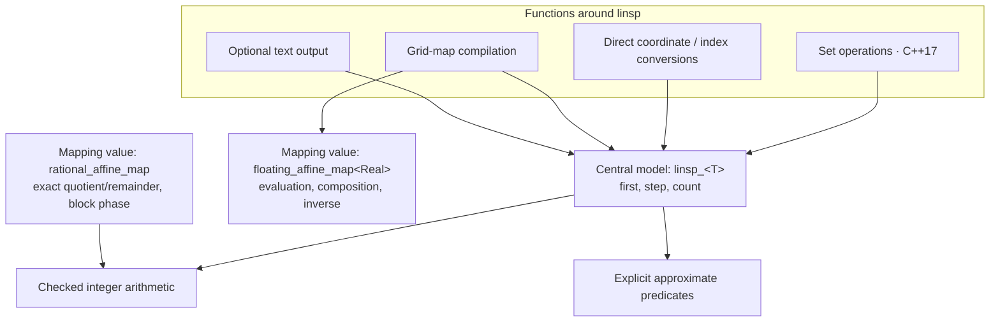

# Architecture and scope

[中文](architecture.zh-CN.md) · [Documentation](README.md) · [Mathematical contracts](semantics.md)

linscaler is a header-only mathematics library for finite uniform sequences and the relationships between their coordinates and indices. `linsp_<T>` is the central data model. Mapping objects describe relationships around that model; they are not alternative sequence containers. The library has no application configuration, data-buffer, device, or execution dependencies.

## The central model

`linsp_<T>(first, step, count)` represents the ordered finite sequence `x(i) = first + step*i`, for integer `0 <= i < count`. Negative and zero steps are valid. A floating coordinate does not make its element ordinal fractional. Continuous index positions are computed by mapping functions, not by indexed element access.

The progression retains its origin, spacing, count and traversal order. Its queries, slices and iterators operate on that model. Set operations deliberately have different semantics: they collapse duplicates and test whether the result can be expressed as one progression.

## Implemented modules

| Role | Header | Responsibility |
| --- | --- | --- |
| Numeric support | `basic/integer.hpp` | Checked int64 arithmetic and signed floor/ceiling division |
| Numeric support | `basic/precision.hpp` | Explicit approximate predicates |
| Central model | `core/linsp.hpp` | Finite uniform sequence, access, queries, slices and iteration |
| Sequence operations | `core/linsp_ops.hpp` | Intersection, union and representability; C++17 |
| Optional presentation | `core/linsp_io.hpp` | Text formatting; the data-model header does not include streams |
| Direct grid operations | `transform/mapper.hpp` | Coordinate/index conversion and existing compatibility helpers |
| Floating relationships | `transform/floating_affine_map.hpp` | Floating affine value, evaluation, composition and inverse |
| Grid-to-map bridge | `transform/grid_map.hpp` | Compile two grids into floating affine coefficients |
| Exact relationships | `transform/rational_affine_map.hpp` | Checked rational affine index evaluation and block phase |
| Compatibility include | `transform/rational_index_map.hpp` | Includes the canonical rational header and preserves the old type name |

In this implementation diagram, arrows point to a dependency. Standard-library and transitive includes are omitted.

`floating_affine_map` is independent of `linsp.hpp`. The bridge is responsible for reading grid parameters. A compiled map stores only coefficients; it does not retain grid ownership, counts or coordinate-system identities. Both direct and compiled grid conversion allow extrapolation. [The mapping guide](mapping.md) explains their numerical differences and when exact rational representation helps.

`rational_affine_map` is the canonical name; `rational_index_map` remains a type alias for source compatibility. Both include paths work. Constructor order, accessors, checked intermediates, rounding and block behavior are unchanged.

## Headers and CMake targets

| CMake target | Minimum standard | Entry points |
| --- | --- | --- |
| `linscaler::core` | C++11 | `core.hpp`, or individual basic/core headers excluding set operations |
| `linscaler::transform` | C++11 | Individual transform headers; depends on `linscaler::core` |
| `linscaler::linscaler` | C++17 | `linscaler.hpp`; includes mappings and set operations |

`core.hpp` includes version, numeric support, progression and text output. It does not include transforms or set operations. Language boundaries follow headers, not folder names: `core/linsp_ops.hpp` is C++17. All public targets are dependency-free INTERFACE targets apart from the standard library. Development warnings, sanitizers and runtime-linkage options stay on development targets.

The C++ namespace remains `linscaler`, with existing subnamespaces. CMake target names are independent of C++ namespaces. The test suite is configured to compile public headers separately and link across translation units; strict C++11 verification requires a compiler that actually supports that mode. Actual execution evidence is recorded in [validation](validation.md).

## Roadmap — not implemented

These are possible extensions, not public interfaces or release requirements. Each needs a concrete mathematical use case and an independent verification basis.

| Candidate | Intended role and required distinction |
| --- | --- |
| `index_interval` | Signed half-open integer index ranges, empty results, intersection and checked translation; endpoint validity does not guarantee representable length |
| Coordinate intervals | Ranges of coordinate values; distinct from integer element ordinals, including for floating grids |
| Input-range queries (preimages) | Find inputs whose outputs satisfy a range condition; start with checked integer/rational maps |
| Explicit rounding conversions | Checked floating-to-integer and exact quotient/remainder quantization; preserve current rounding rules |
| Quantized preimages | Specify finite domains, monotonicity and the exact forward quantization contract; do not expand matches with epsilon |
| Rational normalization/composition | Explicit coefficient reduction and unquantized composition; no automatic change to stored coefficients |
| Compensated arithmetic | Only after defining floating-environment assumptions, invariants and demonstrable guarantees |
| Wider arithmetic and benchmarks | Add when demonstrated domains or measured costs justify them |

An index interval supports the central sequence model; it does not replace it. An exact image set, a containing interval and an input-range query are different results. A bounding interval must not silently fill missing points. Composition of unquantized maps must not be used as a substitute for a chain that rounds between stages. A numerical residual is not a proof of correctness or an error bound.

Future error interfaces should be designed consistently rather than copying application-specific status types. Domain-specific units, identities, acceptance thresholds and rule selection remain with callers. Independent axes may be combined by callers; no multidimensional storage model is part of this API.

