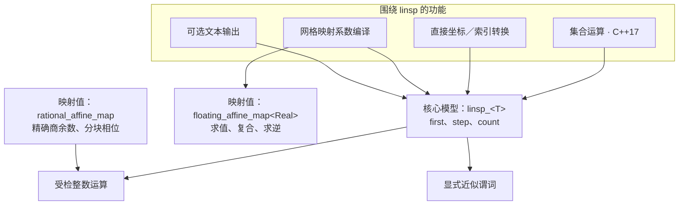

# 架构与范围

[English](architecture.md) · [文档导航](README.zh-CN.md) · [数学契约](semantics.zh-CN.md)

linscaler 是面向有限均匀序列及其坐标、索引关系的纯头文件数学库。`linsp_<T>` 是核心数据模型。映射对象描述围绕该模型产生的关系，不是另外一套序列容器。库不依赖应用配置、数据缓冲区、设备或执行流程。

## 核心模型

`linsp_<T>(first, step, count)` 表示有序有限序列 `x(i) = first + step*i`，其中整数索引满足 `0 <= i < count`。负步长和零步长均合法。坐标可以是浮点数，但元素序号仍是整数；连续索引位置由映射函数计算，不等于可以直接访问的小数序号元素。

等差序列保留原点、间距、数量和遍历方向。查询、切片和迭代都围绕这个模型。集合运算具有不同语义：去除重复点，并判断结果能否由单个等差序列表示。

## 已实现模块

| 角色 | 头文件 | 责任 |
| --- | --- | --- |
| 基础数值 | `basic/integer.hpp` | 受检 int64 运算和带符号向下／向上整除 |
| 基础数值 | `basic/precision.hpp` | 显式近似谓词 |
| 核心模型 | `core/linsp.hpp` | 有限均匀序列、访问、查询、切片与迭代 |
| 序列运算 | `core/linsp_ops.hpp` | 交集、并集及可表示性；要求 C++17 |
| 可选展示 | `core/linsp_io.hpp` | 文本格式化；数据模型头文件本身不引入流 |
| 直接网格运算 | `transform/mapper.hpp` | 坐标／索引转换及既有兼容接口 |
| 浮点关系 | `transform/floating_affine_map.hpp` | 浮点仿射值对象、求值、复合与求逆 |
| 网格与映射桥接 | `transform/grid_map.hpp` | 从两条网格编译浮点仿射系数 |
| 精确关系 | `transform/rational_affine_map.hpp` | 受检有理数仿射索引求值和分块相位保持 |
| 兼容入口 | `transform/rational_index_map.hpp` | 包含正式有理数头文件并保留旧类型名 |

下图只展示已实现模块。箭头指向依赖项，省略标准库及传递依赖。

`floating_affine_map` 不依赖 `linsp.hpp`，由桥接接口负责读取网格参数。编译后的映射仅保存系数，不保存网格所有权、数量或坐标系身份。直接转换与编译后的转换都允许外推。[映射指南](mapping.zh-CN.md)说明两者的数值差异，以及精确有理数表示的适用范围。

`rational_affine_map` 是正式名称，`rational_index_map` 保留为类型别名以兼容已有源码。两个包含路径都可使用，构造参数顺序、访问器、受检中间运算、舍入和分块行为均不变。

## 头文件与 CMake 目标

| CMake 目标 | 最低标准 | 入口 |
| --- | --- | --- |
| `linscaler::core` | C++11 | `core.hpp`，或不含集合运算的独立 basic/core 头文件 |
| `linscaler::transform` | C++11 | 独立 transform 头文件；依赖 `linscaler::core` |
| `linscaler::linscaler` | C++17 | `linscaler.hpp`；包含映射与集合运算 |

`core.hpp` 包含版本、基础数值、等差序列和文本输出，不包含映射或集合运算。语言标准边界按头文件划分，不由目录名决定：`core/linsp_ops.hpp` 要求 C++17。公共目标均为 INTERFACE 目标，除标准库外无外部依赖。开发告警、sanitizer 和运行库链接选项只属于开发目标。

C++ 根命名空间及现有子命名空间保持 `linscaler` 不变。CMake 目标名与 C++ 命名空间是独立机制。测试配置会分别编译公共头文件并跨翻译单元链接；严格 C++11 验证必须使用真正提供该语言模式的编译器。实际执行证据见[验证记录](validation.zh-CN.md)。

## 路线图——尚未实现

以下是候选扩展，不是已提供的公共接口，也不是所有版本都必须完成的发布要求。每一项都需要明确的数学使用场景和独立验证依据。

| 候选能力 | 用途与必须区分的语义 |
| --- | --- |
| `index_interval` | 有符号半开整数索引范围、空结果、交集和受检平移；端点合法不保证长度可表示 |
| 坐标区间 | 描述坐标值范围；即使网格坐标为浮点数，也应与整数元素序号区分 |
| 输入范围反查（原像） | 找到输出满足范围条件的输入；先实现受检整数／有理数路径 |
| 显式舍入转换 | 受检浮点到整数转换，以及商余数的精确量化；保留已有舍入规则 |
| 量化后的输入范围反查 | 明确有限定义域、单调性及正向量化契约；不使用 epsilon 扩大命中范围 |
| 有理数正规化／复合 | 显式约分及未量化复合；不自动改变已保存的系数 |
| 补偿数值计算 | 先明确浮点环境前提、不变量和可证明的保证，再决定公开 |
| 更宽整数及性能基准 | 由实际数值域或测量结果证明必要性后加入 |

索引区间辅助核心序列模型，不替代 linsp。精确像集、包围区间和输入范围反查是不同结果；包围区间不能悄悄填平缺失点。未量化映射的复合不能代替中间发生舍入的计算链。数值残差既不是正确性证明，也不是误差上界。

后续错误接口应统一设计，不复制应用专有状态类型。业务单位、身份、接受阈值和规则选择由调用方负责。调用方可以组合独立轴；公共 API 不包含多维存储模型。
